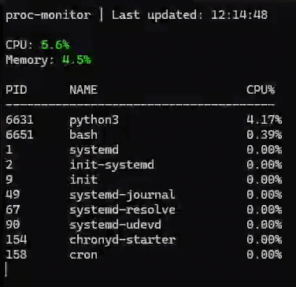
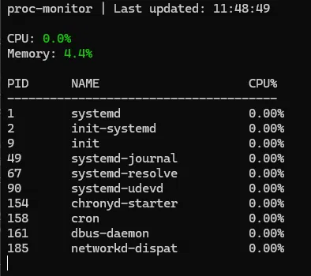
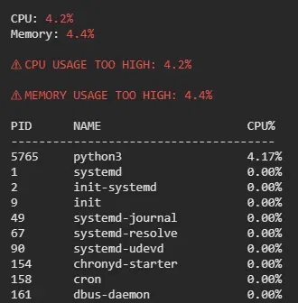

# proc-monitor

Lightweight Linux system monitor that reads directly from `/proc` — no external dependencies.

## Features
- CPU usage (aggregate, sampled every 3 seconds)
- Memory usage (total, available, % used)
- Top 10 processes by CPU usage
- Spike alerts for CPU and memory thresholds

## How it works

Rather than relying on third-party libraries like `psutil`, proc-monitor reads directly from the Linux `/proc` virtual filesystem — the same source those libraries use under the hood. CPU usage is calculated by sampling the cumulative counters in `/proc/stat` one second apart and computing the delta. Process CPU usage works the same way using `utime` and `stime` from `/proc/[pid]/stat`. Memory is read from `/proc/meminfo` using `MemTotal` and `MemAvailable`.

## Screenshots

## Requirements
- Linux (or WSL)
- Python 3.x

## Usage
python3 main.py